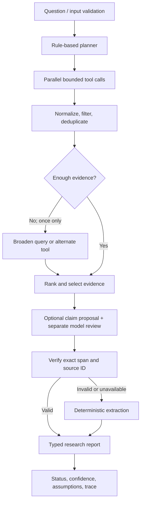

# Veritas — evidence-first research agent

A focused Platform Engineer take-home submission for Predixion AI. Veritas is a bounded, read-only planner–executor that retrieves evidence, filters noise, verifies cited spans, and returns a structured answer or an explicit abstention. The agent runs through both a CLI and a responsive web workspace.

## Quick start

Python 3.10+; no third-party runtime dependencies. From the repository root:

```bash
python -m veritas "Find 5 Indian B2B SaaS startups in HR tech and summarize their positioning."
python -m veritas "Compare the top 3 open-source vector databases for a startup building RAG products." --fault timeout
python -m veritas "Compare vector databases for RAG" --fault outage --json
python -m unittest discover -s tests -v
python evaluate.py
python baseline.py
```

Default `demo` mode searches a local, authored fixture corpus. It is not a live web snapshot, and the citations are reference URLs rather than proof of current page content. Faults are simulated, explicitly enabled, and cannot be used in live mode. No secret is required. JSON is available with `--json`; `--output report.json` saves the full report.

### Live research

```bash
# macOS/Linux; on Windows PowerShell use $env:NAME = 'value'
export TAVILY_API_KEY='your-key'       # optional; recommended for general research
export GROQ_API_KEY='your-key'      # optional; enables model-based span selection
export GROQ_MODEL='openai/gpt-oss-120b'     # configurable; use a model supporting JSON mode
# export GITHUB_TOKEN='your-token'   # optional; increases GitHub API quota
python -m veritas "Compare vector databases for RAG" --mode live --json
```

Wikipedia and GitHub use public REST endpoints; Tavily Search uses its API with basic search depth and automatic depth selection disabled to limit credit usage. Without Tavily the general research coverage is limited, and without Groq the answer is deterministic and extractive. Live mode **never** silently falls back to fixture data. The live path could not be verified against external services in the build environment because DNS failed; `docs/live-network-check.json` captures the actual unsuccessful attempt. The Groq response contract is tested with a mock. A user-reported deployed live run returned two cited vector-database findings; CP13 addresses incomplete comparative synthesis. Post-change live quality still requires verification. Run a live smoke test before presenting this as a verified live service. API access, quotas, and provider billing remain the operator's responsibility.

## Architecture



**Why an agent?** The information needed is not known in advance. The next retrieval action depends on the question and the evidence returned. A fixed chat prompt cannot independently recover from a failed provider. This is a constrained single agent, not a multi-agent system; deterministic routing is easier to inspect and test than a fully autonomous model loop. Its adaptive behavior is conditional replanning, not a claim of autonomous reasoning.

**Tools:** GitHub search for repository descriptions; Wikipedia for background and concepts; Tavily Search for broader research and official positioning. Business questions prefer web search, technical questions include repository search, and general questions prefer background/broad discovery. Routing uses keywords and a small set of domain-specific anchors; unfamiliar or multilingual questions can be misrouted.

**Data flow:** `Step`, `Evidence`, `Finding`, and `Report` dataclasses define the output contract. `planner.py` proposes up to three initial steps. `agent.py` executes them concurrently, normalizes rows, rejects malformed entries, invalid URL schemes/hosts, obvious injection phrases, and weak lexical matches, then deduplicates by normalized URL and ranks using relevance and domain diversity. Live list/comparison questions use up to two complementary web searches in one bounded follow-up phase; there are no predefined candidate lists in the active research path. The model proposes structured sections and atomic claims with exact quotes; deterministic validation rejects fabricated spans, cross-entity names, and noisy fragments. A separate Groq review receives proposed claims and exact supporting passages; missing, malformed, or rejected verdicts withhold paraphrased claims. Coverage counts reviewed distinct labels or benefit/risk categories, not URLs. Exact passages remain available on failure. The reviewer is the same provider/model by default, so its judgments are not independent truth or formal entailment verification.

## Reliability, security and tradeoffs

| Concern | Implemented decision | Remaining gap |
|---|---|---|
| Timeouts and retries | 4-second socket timeout per retrieval attempt; max two attempts; retry transient HTTP/network failures; 150 ms fixed delay | Not a strict wall-clock deadline; use cancellable clients, exponential backoff/jitter, Retry-After and circuit breakers |
| Cost and latency | Up to 3 parallel initial steps plus 2 complementary queries in one phase; max 10 retrieval attempts for live structured queries, 8 otherwise; max 2 model calls; capped sources and model output | Track tokens, actual cost, provider quotas and p95 latency; cap total request duration |
| Malformed output | Validate expected object/row shapes; error categories; safe fallback | Stronger provider schemas and contract integration tests |
| Weak results | Lexical relevance and domain-specific anchors, URL deduplication, domain diversity | Semantic relevance, source authority scoring, publication date, entity coverage and independent corroboration |
| Hallucination | Exact source ID/span validation; abstain without evidence | A real source can still be false, stale or out of context; exact matching is not entailment |
| Prompt injection | Treat sources as data; suspicious phrase heuristic; fixed read-only endpoints; model cannot run commands | Heuristic is bypassable; need adversarial evaluation and isolation; avoid trusting snippets |
| Confidence | Low/medium heuristic based on source count, domains, failures; no numeric probability or unvalidated high confidence | Calibrate with labeled queries and human review; count sources is not count of distinct entities |
| Tracing | Stage, tool, attempts, elapsed ms, status and rejection codes in each report | Export structured traces to OpenTelemetry; avoid logging raw questions or secrets centrally |
| Privacy | No persistent storage or API keys in repository; no arbitrary server-side fetching | Live providers receive query text; model receives question and retained evidence. Add consent, redaction, retention controls |

`complete` means sufficient records for the bounded workflow without a detected error, **not** proven factual correctness. `partial` means a known coverage limitation, ranking/recency uncertainty, unavailable provider, or other incomplete evidence. `insufficient` means no accepted evidence. In demo mode these statuses describe fixture behavior only. An evidence span can be misleading even if exact; never treat this as an autonomous decision authority. The agent does not confirm “top” rankings or freshness using snippets. It does not automatically retrieve full primary-source pages.

## Repository layout

```
veritas/     contracts, planner, adapters, fixture corpus, model, agent, CLI
tests/       deterministic and mocked adapter regression tests
evaluate.py  11 scenario checks; writes samples and evaluation results
baseline.py single-tool comparison on the same fixture inputs
samples/    3 generated JSON reports: HR, vector search, total outage
docs/       evaluation, checkpoints, logs, walkthrough script
.github/    CI workflow
```

## Evaluation and production roadmap

See [evaluation notes](docs/EVALUATION.md), [machine-readable results](docs/evaluation-results.json), [baseline results](docs/baseline-results.json), and [checkpoints](docs/CHECKPOINTS.md). The included checks measure behavior and contract integrity; they are not a statistical factual-accuracy benchmark. Next: live provider smoke tests; human-labeled diverse questions and adversarial sources; claim-level entailment and primary-source verification; query budgeting and rate limiting; calibrated confidence, tenant isolation, and observability. Monitor latency by provider, failure/retry rate, zero-result rate, source diversity, citation rejection, abstention rate, token/cost per run, and human-scored answer quality. The CLI remains fully usable without a deployment. The web workspace runs the same engine via a bounded Python HTTP endpoint.

## Demo and submission

The separate MP4 is a narrated walkthrough of actual offline CLI/evaluation runs, with simulated faults labeled. A human-presented recording can be made using [the demo script](docs/DEMO.md). Share the separate demo via a viewable link. A user-reported live run demonstrated that the deployed agent returned cited findings, but comparative completeness and provider-specific success require inspection of the execution trace.


## Web workspace / Vercel

Run `python web_server.py` and open `http://localhost:8000`. The static responsive frontend calls `/api/research`, which directly invokes the original Python agent, not a mock UI or a rewritten engine. The research workspace includes clickable evidence IDs, plan and trace views, JSON export, a failure lab, recorded evaluation results with rerun controls, and architecture notes. Trace events are returned after the request finishes (not streamed).

Deployment: import this repository into Vercel; the root `vercel.json` configures the static `public/` output and a Python function. Public demo mode requires no API keys. To enable live mode, add these variables to the project's **Production** environment and redeploy:

| Variable | Purpose |
|---|---|
| `GROQ_API_KEY` | Optional model-based evidence span selection |
| `TAVILY_API_KEY` | Broad live web search via Tavily; recommended |
| `GROQ_MODEL` | Optional, defaults to `openai/gpt-oss-120b` |

Adding either provider key enables public live research with no access code; add both for broad web search and model-assisted evidence selection. The default open-weight GPT-OSS 120B model is hosted by Groq and uses only GROQ_API_KEY; GROQ_MODEL can override it with another supported JSON-mode model. Keys remain server-side. Per-run limits remain in place, but there is no distributed rate limiting or authentication: configure provider quotas/spend limits and Vercel abuse protections before sharing widely. Demo mode remains available. Historical evaluation metrics are fixture-based, not factual-accuracy claims.

Web boundary regression checks are included in `tests/test_web.py`; `python -m unittest discover -s tests -v` runs the complete regression suite.
