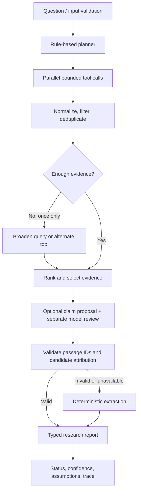

# Veritas — evidence-first research agent

A focused, evidence-first research prototype for Predixion AI. Veritas is a bounded, read-only planner–executor that retrieves evidence, filters noise, proposes claim-level synthesis, and returns a structured answer or an explicit abstention. The agent runs through a CLI and responsive web workspace.

## Quick start

Python 3.10+; no third-party runtime dependencies. From the repository root:

```bash
python -m veritas "Find 5 Indian B2B SaaS startups in HR tech and summarize their positioning."
python -m veritas "Compare the top 3 open-source vector databases for a startup building RAG products." --fault timeout
python -m veritas "Compare vector databases for RAG" --fault outage --json
python -m unittest discover -s tests -v
python evaluate.py
python baseline.py
```

Default `demo` mode searches a local, authored fixture corpus. It is not a live web snapshot, and the citations are reference URLs rather than proof of current page content. Faults are simulated, explicitly enabled, and cannot be used in live mode. No secret is required. JSON is available with `--json`; `--output report.json` saves the full report.

### Live research

```bash
# macOS/Linux; on Windows PowerShell use $env:NAME = 'value'
export TAVILY_API_KEY='your-key'       # optional; recommended for general research
export GROQ_API_KEY='your-key'      # optional; enables model-based span selection
export GROQ_MODEL='openai/gpt-oss-120b'     # configurable; use a model supporting JSON mode
# export GITHUB_TOKEN='your-token'   # optional; increases GitHub API quota
python -m veritas "Compare vector databases for RAG" --mode live --json
```

Wikipedia and GitHub use public REST endpoints; Tavily Search uses basic search, with automatic depth selection disabled to limit credit use. Without Tavily, general research coverage is limited; without Groq, live answers use a deterministic evidence fallback. Live mode **never** silently falls back to fixtures. On 2026-11-27, the public site and `cp30-prototype` API loaded and accepted controlled live queries with both providers configured. See [evaluation notes](docs/EVALUATION.md) for the observed vector-database and HR-tech gaps; successful provider calls do not establish answer correctness. API access, quotas, and billing remain the operator's responsibility. `docs/live-network-check.json` is a historical failed-network run, not the current availability result.

## Architecture



**Why an agent?** The information needed is not known in advance. The next retrieval action depends on the question and the evidence returned. A fixed chat prompt cannot independently recover from a failed provider. This is a constrained single agent, not a multi-agent system; deterministic routing is easier to inspect and test than a fully autonomous model loop. Its adaptive behavior is conditional replanning, not a claim of autonomous reasoning.

**Tools:** GitHub search for repository descriptions; Wikipedia for background and concepts; Tavily Search for broader research and official positioning. Business questions prefer web search, technical questions include repository search, and general questions prefer background/broad discovery. Routing uses keywords and a small set of domain-specific anchors; unfamiliar or multilingual questions can be misrouted.

**Live data flow:** `research_v2.py` decomposes intent into bounded requirements, retrieves complementary evidence, selectively extracts up to three discovered pages through Tavily, and indexes preserved passages in `grounding.py`. Models cite immutable passage IDs rather than reproducing quotes. A separate reviewer evaluates atomic claims; deterministic validation checks citation IDs, numbers, eligibility qualifiers, explicit candidate subjects, passage attribution, and whether a feature is assigned to a different named product in the same evidence. One bounded recovery pass targets missing requirements. These lexical guards are conservative and cannot establish general semantic entailment. `telemetry.py` returns per-run trace, timing, error codes, token use, estimated credits and privacy-minimized Vercel log summaries. Offline demo retains its deterministic fixtures and failure scenarios. See `docs/RESEARCH_V2.md` for budgets and limitations.

## Reliability, security and tradeoffs

| Concern | Implemented decision | Remaining gap |
|---|---|---|
| Timeouts and retries | 4-second socket timeout per retrieval attempt; max two attempts; retry transient HTTP/network failures; 150 ms fixed delay | Not a strict wall-clock deadline; use cancellable clients, exponential backoff/jitter, Retry-After and circuit breakers |
| Cost and latency | Live: at most 5 basic web searches, one extraction batch, 5 model calls, 48-second soft budget; demo: max 8 retrieval attempts; capped sources and model output | Track tokens, actual cost, provider quotas and p95 latency; cap total request duration |
| Malformed output | Validate expected object/row shapes; error categories; safe fallback | Stronger provider schemas and contract integration tests |
| Weak results | Lexical relevance and domain-specific anchors, URL deduplication, domain diversity | Semantic relevance, source authority scoring, publication date, entity coverage and independent corroboration |
| Hallucination | Exact source ID/span validation; abstain without evidence | A real source can still be false, stale or out of context; exact matching is not entailment |
| Prompt injection | Treat sources as data; suspicious phrase heuristic; fixed read-only endpoints; model cannot run commands | Heuristic is bypassable; need adversarial evaluation and isolation; avoid trusting snippets |
| Confidence | Live: medium requires complete requested coverage, model-reviewed claims, healthy providers and at least two sources; otherwise low. Demo: authored-fixture heuristic. Any partial/insufficient report is low. Never a probability. | Calibrate against human-reviewed queries; coverage and citations do not establish truth |
| Tracing | Stage, tool, attempts, elapsed ms, status and rejection codes in each report | Export structured traces to OpenTelemetry; avoid logging raw questions or secrets centrally |
| Privacy | No persistent storage or API keys in repository; no arbitrary server-side fetching | Live providers receive query text; model receives question and retained evidence. Add consent, redaction, retention controls |

`complete` means sufficient records for the bounded workflow without a detected error, **not** proven factual correctness. `partial` means a known coverage limitation, ranking/recency uncertainty, unavailable provider, or other incomplete evidence. `insufficient` means no accepted evidence. In demo mode these statuses describe fixture behavior only. An evidence span can be misleading even if exact; never treat this as an autonomous decision authority. The agent does not confirm “top” rankings or freshness using snippets. It does not automatically retrieve full primary-source pages.

Every report includes the question, short answer, key findings, cited sources, confidence level, limitations, assumptions and suggested next steps. Live confidence is separate from candidate/criterion coverage, citation linkage, evidence-review status and provider health; an incomplete answer can still include useful claims.

## Repository layout

```
veritas/     contracts, planner, adapters, fixture corpus, model, agent, CLI
tests/       deterministic and mocked adapter regression tests
evaluate.py  11 scenario checks; writes samples and evaluation results
baseline.py single-tool comparison on the same fixture inputs
samples/    3 generated JSON reports: HR, vector search, total outage
docs/       evaluation, checkpoints, logs, walkthrough script
.github/    CI workflow
```

## Evaluation and production roadmap

See [evaluation notes](docs/EVALUATION.md), [machine-readable offline results](docs/evaluation-results.json), [baseline results](docs/baseline-results.json), and [checkpoints](docs/CHECKPOINTS.md). Unit/fault tests use authored fixtures and mocked provider calls; they are not a factual-accuracy benchmark. The live sample runs in the evaluation report are direct provider observations, manually inspected but too small to establish accuracy. A stronger evaluation needs human-labeled queries, adversarial/conflicting sources, claim-level source review, and measured calibration. Production work would add request-level abuse/rate controls, strict cancellable deadlines, durable privacy-reviewed telemetry, and independent human quality monitoring. The web workspace runs the same Python engine through a bounded endpoint.

## Demo and submission

The repository includes a timed recording script in [docs/DEMO.md](docs/DEMO.md). No screen recording is included; recording and hosting a 3–5 minute demo remains a manual submission step. The script distinguishes live research from simulated failure cases.


## Web workspace / Vercel

Run `python web_server.py` and open `http://localhost:8000`. The static responsive frontend calls `/api/research`, which directly invokes the original Python agent, not a mock UI or a rewritten engine. The research workspace includes clickable evidence IDs, plan and trace views, JSON export, a failure lab, recorded evaluation results with rerun controls, and architecture notes. Trace events are returned after the request finishes (not streamed).

Deployment: import this repository into Vercel; the root `vercel.json` configures the static `public/` output and a Python function. Public demo mode requires no API keys. To enable live mode, add these variables to the project's **Production** environment and redeploy:

| Variable | Purpose |
|---|---|
| `GROQ_API_KEY` | Optional model-based intent planning, passage-linked synthesis and review |
| `TAVILY_API_KEY` | Broad live web search via Tavily; recommended |
| `GROQ_MODEL` | Optional, defaults to `openai/gpt-oss-120b` |

Adding either provider key enables public live research with no access code; add both for broad web search and model-assisted evidence selection. The default open-weight GPT-OSS 120B model is hosted by Groq and uses only GROQ_API_KEY; GROQ_MODEL can override it with another supported JSON-mode model. Keys remain server-side. Per-run limits remain in place, but there is no distributed rate limiting or authentication: configure provider quotas/spend limits and Vercel abuse protections before sharing widely. Demo mode remains available. Historical evaluation metrics are fixture-based, not factual-accuracy claims.

Web boundary regression checks are included in `tests/test_web.py`; `python -m unittest discover -s tests -v` runs the complete regression suite.

## Production diagnostics

Public live requests expose a per-run `run_id`, stage/error counts, token usage reported by Groq, and a conservative estimated basic Tavily search/extract credit count. Enable **Include retained evidence snapshot** to export evidence text with stable passage IDs. Vercel runtime logs contain only bounded numeric/status summaries, no questions, URLs, prompts or evidence. Provider billing, rate limiting and durable telemetry storage are not implemented. See [research engine and evaluation](docs/RESEARCH_V2.md).

**Groq quota controls:** `GROQ_AUX_MODEL` (optional, defaults to `openai/gpt-oss-20b`) handles planning/review; `GROQ_MODEL` (default `openai/gpt-oss-120b`) handles synthesis. Evidence context is capped and compacted, reviewer inputs deduplicated, and rate-limit headers surfaced. Rate-limit failures stop additional model calls instead of retrying blindly. Actual organization quotas are account-specific.

### Prototype report metrics
Live reports distinguish heuristic confidence, evidence status (model-reviewed / retrieved only / no evidence), citation linkage, criterion and candidate coverage, and provider health. None is an independent truth check. Numbered lists use a compact eligibility/positioning rubric (plus tradeoffs for comparisons), with explicit question constraints still required. A reviewer may correct a claim's criterion but cannot rewrite the claim or change its citations. No extra services or infrastructure are used.
